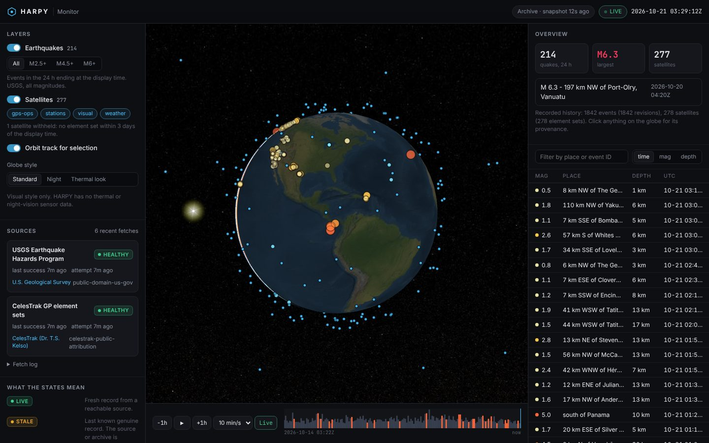
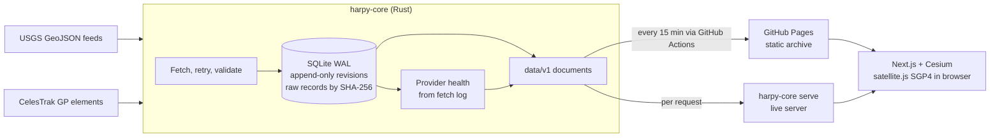
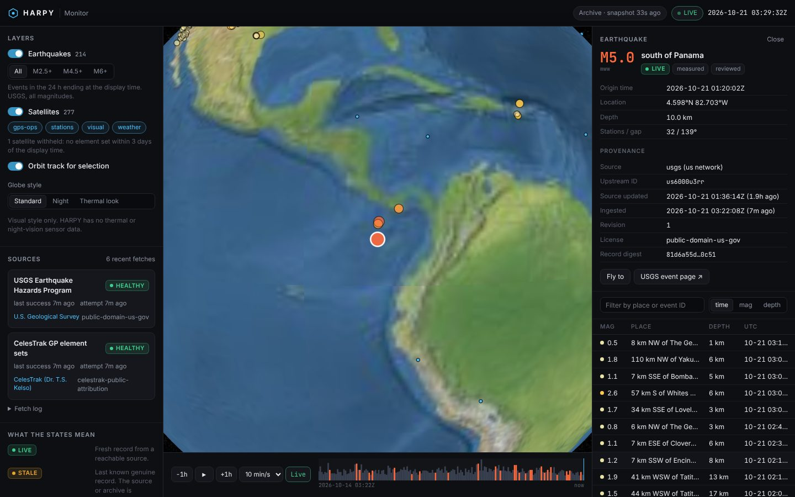
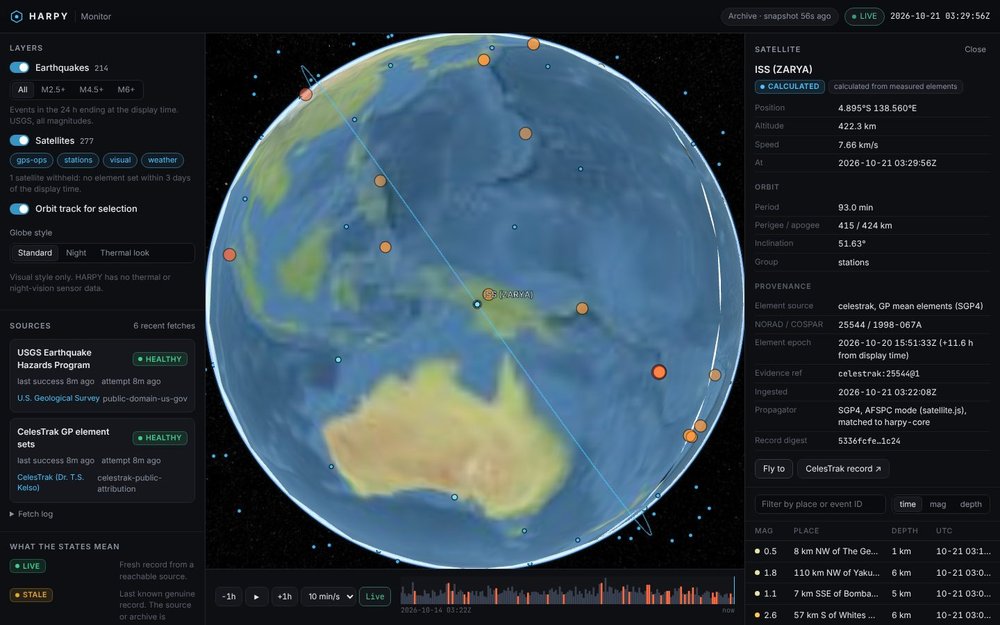
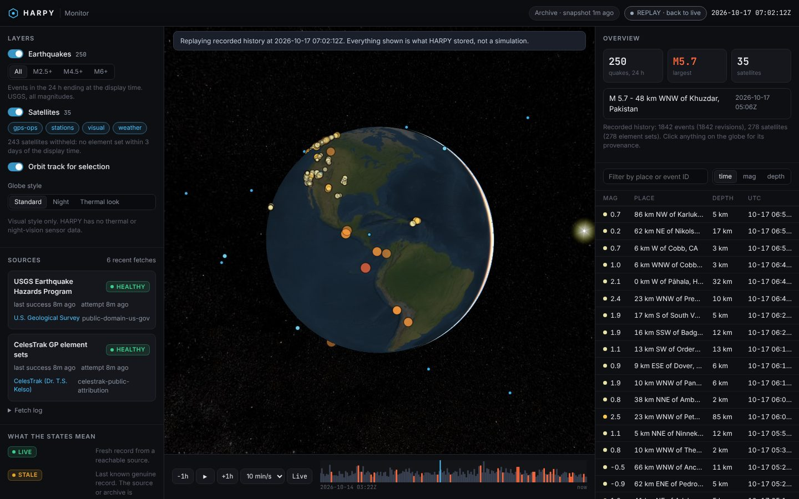
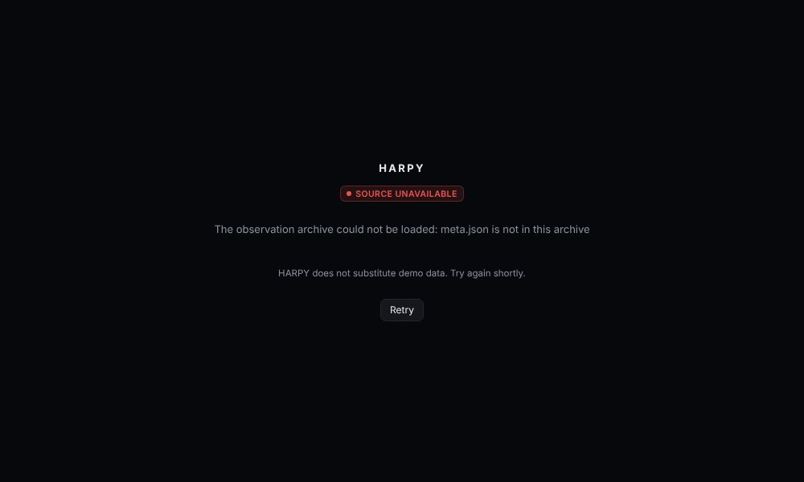

# HARPY Monitor

A geospatial monitor that only shows real data, says where every point came from, and tells you plainly when a source is down.



- **Earthquakes** from the USGS real-time feeds, every magnitude, with revision history when USGS corrects an event.
- **Satellites** (ISS and other stations, bright satellites, GPS, weather) propagated in your browser with SGP4 from CelesTrak element sets, cross-checked against the Rust backend.
- **Replay** of everything HARPY recorded (30 days of events, 10 days of element sets), with day/night lighting at the replay time.
- **Provenance** on click: upstream ID, source-updated vs ingested time, revision, license, and a SHA-256 of the exact upstream record.
- **Honest failure:** outages show as `SOURCE_UNAVAILABLE` or `STALE`. There is no mock mode, no demo stream, and no fallback data anywhere in the shipped build.

## Status

| | |
|---|---|
| Live data pipeline | **Proven in production.** The first scheduled run fetched 1,842 USGS events and 278 CelesTrak element sets, all HTTP 200, zero invalid records, and passed all 13 live acceptance checks. See [the evidence report](docs/evidence/2026-10-21-first-live-run.md). |
| CI | Rust fmt, clippy `-D warnings`, 22 tests; web typecheck, lint, 16 tests, production build, no-mock guard |
| Public site | Publishes to `https://angelp17.github.io/HARPY/` once GitHub Pages is enabled (Settings → Pages → Source: GitHub Actions). Until then each run still ingests and saves the database; only the publish step is skipped. |
| Milestone B (GeoWraith) | Not started. Blocked on model assets and an accuracy gate ([ADR 0002](docs/decisions/0002-geowraith-accuracy-gate.md)). |

## How it works



Full diagrams (ingest lifecycle, production pipeline, schema, revisions, health state machine, display states, SGP4, replay, frontend, deployments, test lanes, failure modes): **[docs/architecture.md](docs/architecture.md)**.

## Screenshots

All from the first production database, rendered by the production build.

| Earthquake provenance | Satellite (SGP4) |
|---|---|
|  |  |
| **Replay of recorded history** | **Archive unavailable (no demo fallback)** |
|  |  |

Deep links: `#eq=<USGS event id>` or `#sat=<NORAD id>`, e.g. `#sat=25544` for the ISS.

## Run it

```bash
npm ci
make test            # Rust + web tests against recorded real-source fixtures
make ingest          # pull real data into data/harpy.sqlite
make dev             # http://localhost:3000
# or
make serve           # harpy-core live server + web at http://127.0.0.1:8080
```

Requires Rust stable and Node 22. Configuration: [docs/operations/configuration.md](docs/operations/configuration.md).

## Verification

| Claim | Evidence |
|---|---|
| Real data, today | `monitor.yml` live acceptance on every run; [first-run evidence](docs/evidence/2026-10-21-first-live-run.md) with verifiable USGS links |
| SGP4 is correct | Vallado verification vectors match to < 1 cm (`orbit.rs`) |
| Browser and backend agree | Rust golden positions reproduced by satellite.js within ~5 m (`orbit.test.ts`) |
| Revisions preserve history | Integration test: USGS corrects a magnitude, revision 1 and its raw record survive |
| Outages are honest | Integration test: two failed fetches make the provider `UNAVAILABLE`; nothing is synthesized |
| HTTP 200 garbage is a failure | Integration test |
| Restart and backup are safe | Integration tests: reopen identical; `VACUUM INTO` backup passes integrity check |
| No mocks ship | `check-no-mocks.mjs` scans the production bundle in CI |

## Documentation

| Doc | What it covers |
|---|---|
| [architecture.md](docs/architecture.md) | Every moving part, with Mermaid diagrams |
| [contracts/observation.md](docs/contracts/observation.md) | The data contract and display-state rules |
| [evidence/2026-10-21-first-live-run.md](docs/evidence/2026-10-21-first-live-run.md) | What the first production run fetched, stored, and passed |
| [audit/2026-10-current-state.md](docs/audit/2026-10-current-state.md) | What the previous HARPY actually did (mostly mock data) |
| [decisions/](docs/decisions/) | ADR 0001 architecture, ADR 0002 GeoWraith accuracy gate |
| [providers.md](docs/providers.md) | Sources, licenses, and usage terms |
| [operations/runbook.md](docs/operations/runbook.md) | Setup, incidents, backup and restore drill |
| [HARPY_DIRECTIVE.md](docs/HARPY_DIRECTIVE.md) | The engineering directive this work follows |

## Roadmap

Milestone B (HARPY 1.0): GeoWraith visual geolocation as an `inferred` source, saved investigations, and reproducible reports. See the [Milestone B diagram](docs/architecture.md#15-roadmap-milestone-b-geowraith).

## Credits

Earthquake data: U.S. Geological Survey. Orbital elements: CelesTrak. Imagery: Natural Earth. Globe: CesiumJS. SGP4: `sgp4` crate, satellite.js.
