# HARPY architecture

How HARPY Monitor v0.1 works, end to end, with diagrams. Every diagram below describes code that exists in this repository; file paths are given so each claim can be checked.

- Contract details: [`docs/contracts/observation.md`](contracts/observation.md)
- Why it is built this way: [`docs/decisions/0001-canonical-architecture.md`](decisions/0001-canonical-architecture.md)
- Proof it runs on real data: [`docs/evidence/2026-10-21-first-live-run.md`](evidence/2026-10-21-first-live-run.md)

## Contents

1. [System overview](#1-system-overview)
2. [Repository map](#2-repository-map)
3. [Ingestion lifecycle](#3-ingestion-lifecycle)
4. [Scheduled production pipeline](#4-scheduled-production-pipeline)
5. [Storage model](#5-storage-model)
6. [Revisions: how corrections are kept](#6-revisions-how-corrections-are-kept)
7. [Provider health](#7-provider-health)
8. [Display states](#8-display-states)
9. [Satellite positions (SGP4)](#9-satellite-positions-sgp4)
10. [Replay](#10-replay)
11. [Web application](#11-web-application)
12. [Deployment topologies](#12-deployment-topologies)
13. [Verification lanes](#13-verification-lanes)
14. [Failure modes](#14-failure-modes)
15. [Roadmap: Milestone B (GeoWraith)](#15-roadmap-milestone-b-geowraith)

---

## 1. System overview

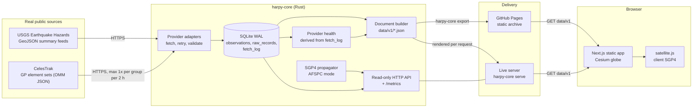

The web app has exactly one way to get data: `GET data/v1/<document>.json`. Both deployments produce the same documents from the same builder (`services/harpy-core/src/export.rs`), so there is no alternate path to fall back to.

## 2. Repository map

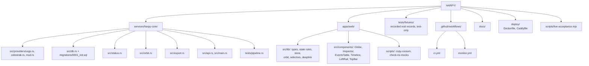

## 3. Ingestion lifecycle

Each fetch, for either provider, follows the same path (`services/harpy-core/src/providers/mod.rs`).

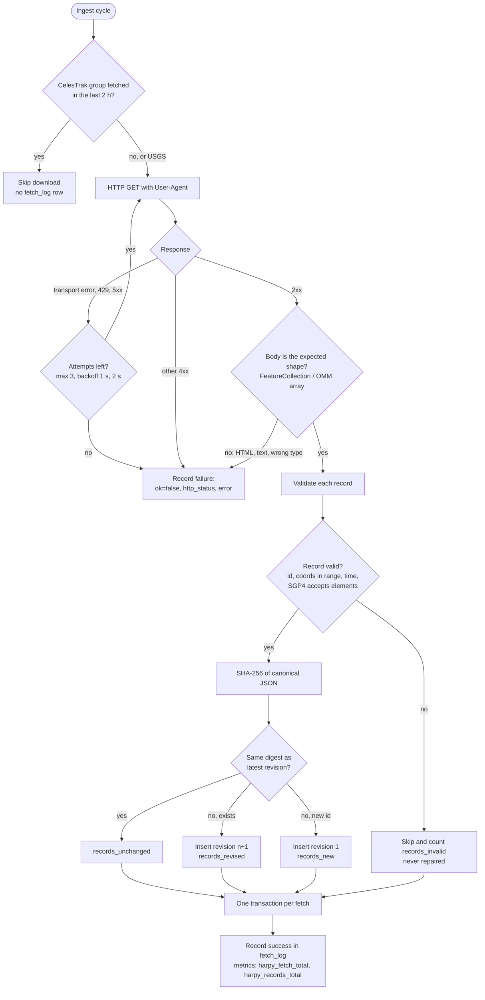

Rules this enforces:

- An empty feed is a successful fetch.
- An HTTP 200 whose body isn't the expected shape is a failure.
- Bad records are skipped and counted, never "fixed".
- Nothing is ever generated to fill a gap.

## 4. Scheduled production pipeline

The public deployment runs as a GitHub Actions workflow every 15 minutes (`.github/workflows/monitor.yml`).

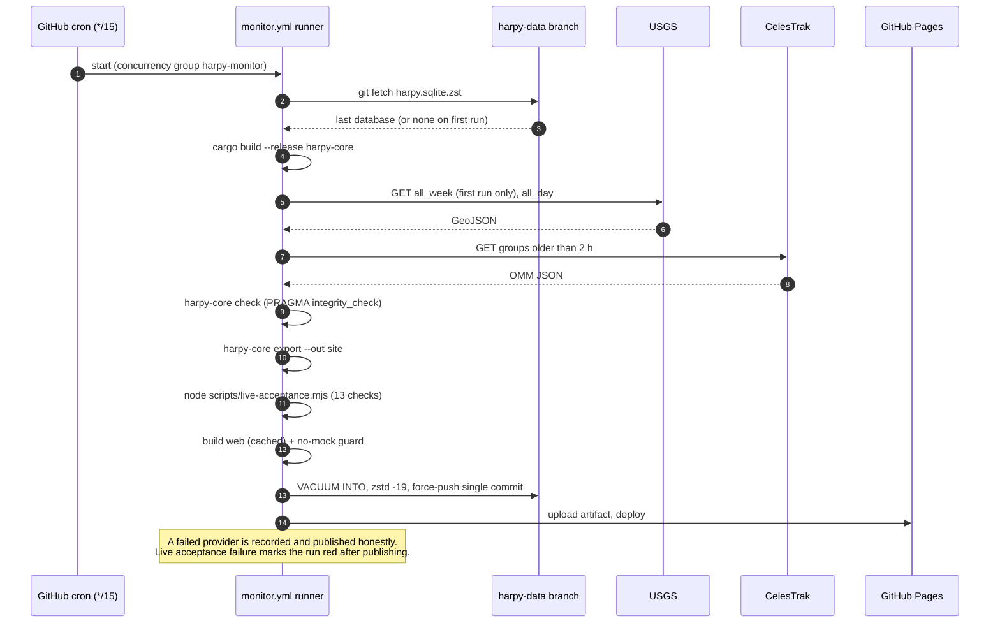

## 5. Storage model

Schema: `services/harpy-core/migrations/0001_init.sql`.

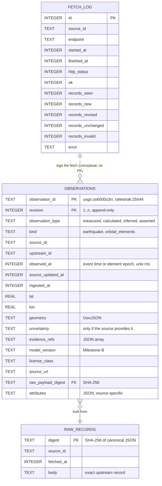

Retention runs after each ingest: earthquakes by event time (30 days on the public deploy), element sets by epoch (10 days), fetch log 14 days, then orphaned raw records.

## 6. Revisions: how corrections are kept

USGS regularly revises events after analyst review. HARPY keeps both versions. Proven in `tests/pipeline.rs`, step 3.

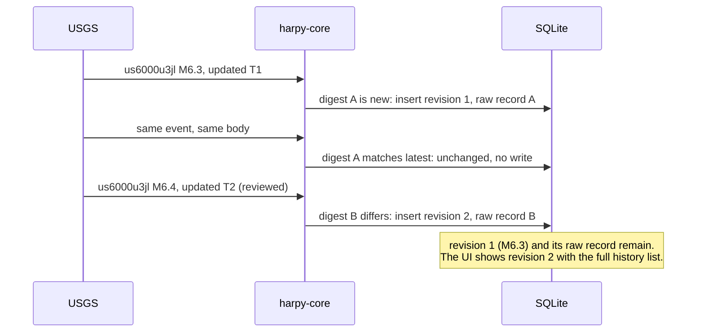

## 7. Provider health

Derived only from `fetch_log` (`services/harpy-core/src/status.rs`), never from how many records came back. Only endpoints attempted in the latest cycle (within 10 minutes of the newest attempt) vote. That stops a one-time bootstrap success from hiding a live outage.

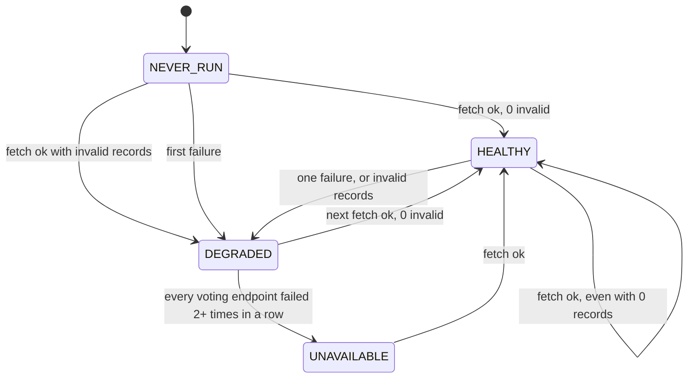

## 8. Display states

Rules in `apps/web/src/lib/state.ts`, unit-tested in `state.test.ts`.

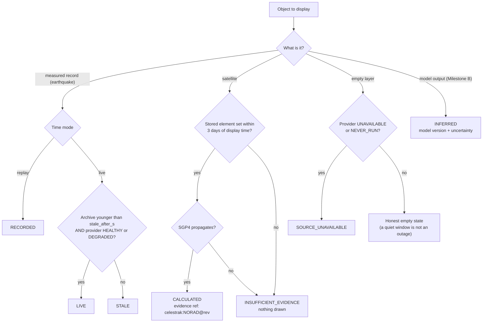

## 9. Satellite positions (SGP4)

The same computation runs in Rust (`orbit.rs`, used by the API and tests) and in the browser (`apps/web/src/lib/orbit.ts`).

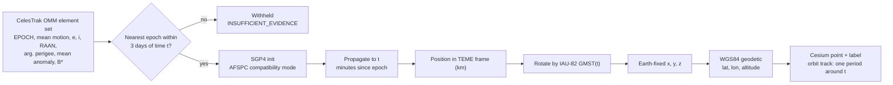

Accuracy evidence:

| Check | Result | Where |
|---|---|---|
| Rust vs Vallado SGP4 verification vectors (sat 00005, t = 0 to 1440 min) | under 1 cm per axis | `orbit.rs` `matches_vallado_verification_vectors` |
| GMST at J2000 vs reference 280.46061837° | under 1e-6° | `orbit.rs` `gmst_at_j2000_matches_reference` |
| Browser (satellite.js 6.0.2) vs Rust golden positions, 6 epochs over 2 days | ~5 m horizontal, ~1 cm altitude | `apps/web/src/lib/orbit.test.ts` |
| SGP4's own model error | ~1 km at epoch, grows 1 to 3 km/day | why the 3-day window exists |

## 10. Replay

Replay reconstructs only what HARPY stored (`apps/web/src/lib/store.ts`, `selectors.ts`).

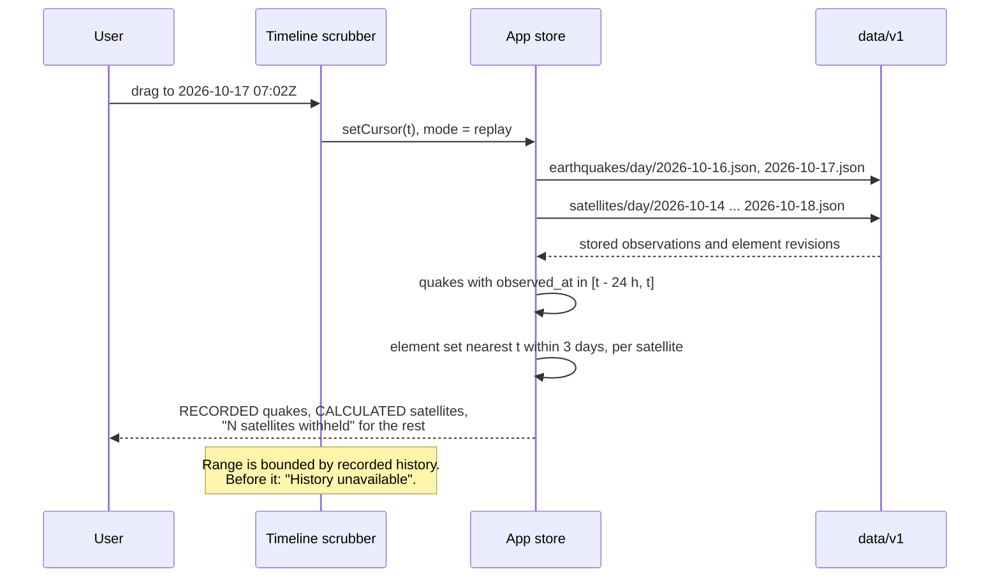

## 11. Web application

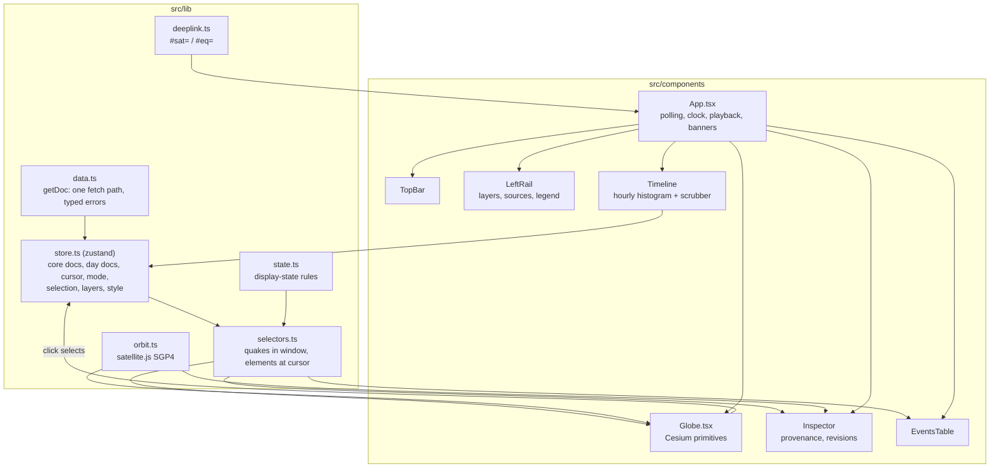

Globe details:

- **Imagery:** Natural Earth II, bundled with CesiumJS and served from this site. No Cesium Ion token, no third-party tiles.
- **Lighting:** the day/night terminator follows the real sun position at the display time.
- **Styles:** Standard, Night, and Thermal look are imagery colour adjustments and are labelled as such. They are not sensor data.

## 12. Deployment topologies

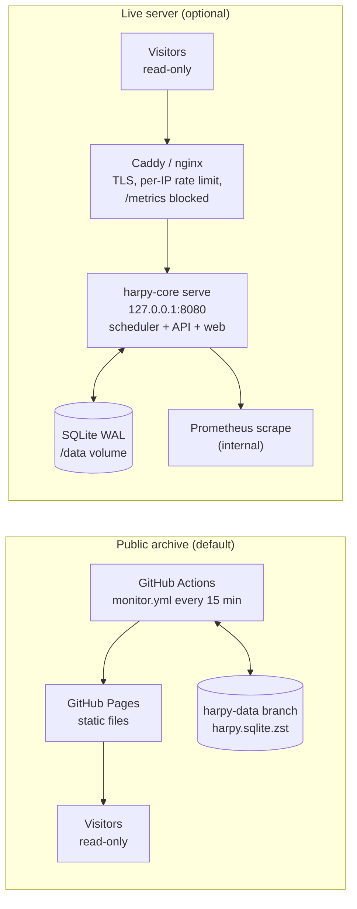

| | Public archive | Live server |
|---|---|---|
| Data cadence | 15 min (GitHub cron can lag) | USGS 60 s, CelesTrak per group 2 h |
| Write surface | None | None (no write routes; POST returns 405) |
| Backups | Every run, to `harpy-data` | `harpy-core backup` (VACUUM INTO) on a timer |
| Cost | Free on a public repo | One small VM |

## 13. Verification lanes

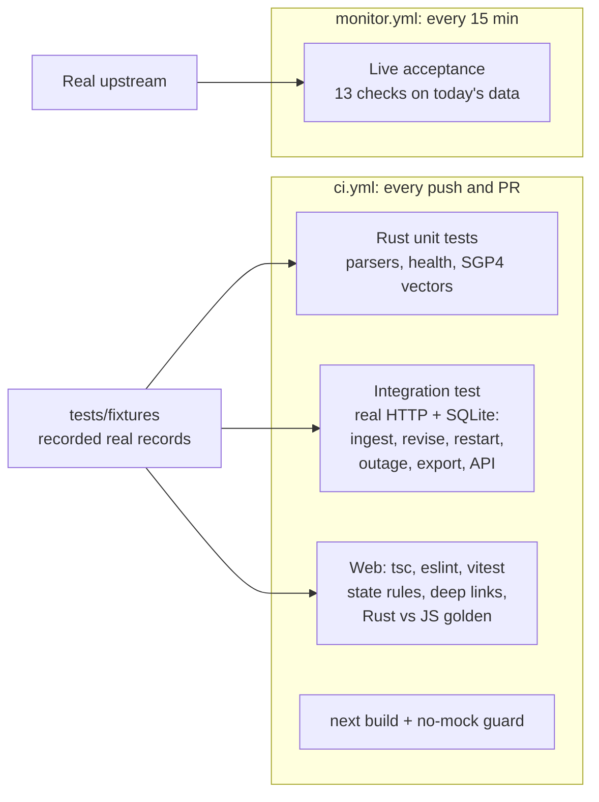

| Lane | Proves | Never proves |
|---|---|---|
| CI | Code is correct and deterministic | That upstream is reachable today |
| Integration | Processes, files, HTTP, and restarts work together | That upstream is reachable today |
| Live acceptance | Real data arrived, IDs are real, timestamps are sane, ISS elements are current | Anything about code paths it didn't exercise |

## 14. Failure modes

| Failure | What HARPY does | Tested in |
|---|---|---|
| USGS returns 503 twice | Provider `UNAVAILABLE`, stored events kept, nothing synthesized, banner shown | `pipeline.rs` step 4 |
| HTTP 200 with an HTML maintenance page | Fetch recorded as failed ("invalid payload") | `pipeline.rs` step 5, `usgs.rs` |
| Empty feed | `HEALTHY`, honest empty window | `status.rs`, `usgs.rs` |
| A record with impossible coordinates | Skipped and counted as invalid; provider `DEGRADED` | `usgs.rs`, `status.rs` |
| CelesTrak plain-text throttle reply | Failure, not data | `celestrak.rs` |
| Element set older than 3 days | Satellite withheld, counted in the UI | `state.test.ts`, `pipeline.rs` step 7 |
| Ingestion stops running | Snapshot age grows; records flip to `STALE`; warning banner | `state.test.ts` |
| Archive can't be loaded at all | Full-screen `SOURCE_UNAVAILABLE`, retry button, no demo data | Screenshot below |
| Process restart | Identical data on reopen | `pipeline.rs` step 2 |
| Database loss | Restore from `harpy-data` or backup file | `backup_produces_consistent_copy`, runbook |

## 15. Roadmap: Milestone B (GeoWraith)

Not built yet. Blocked on model assets and an owner-set accuracy gate ([ADR 0002](decisions/0002-geowraith-accuracy-gate.md)).

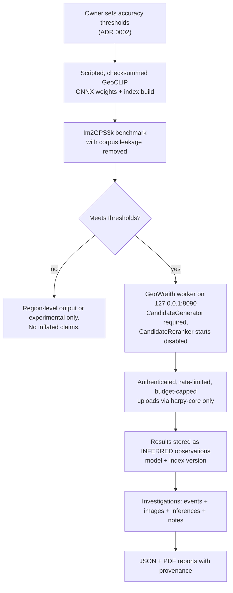
