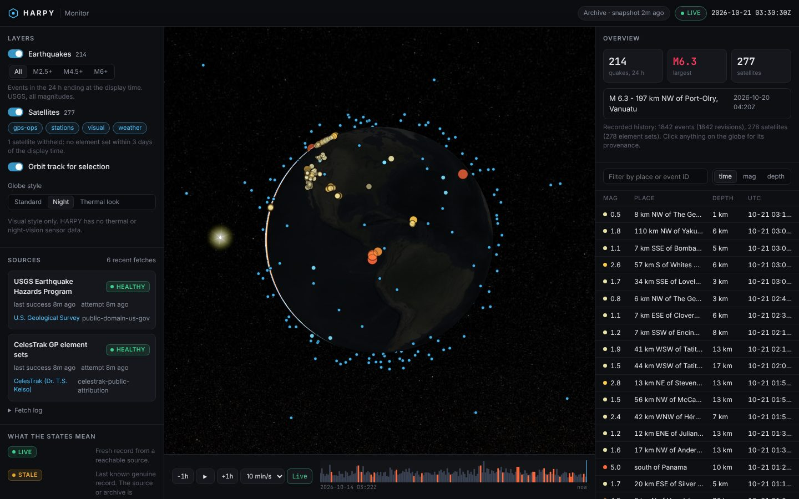
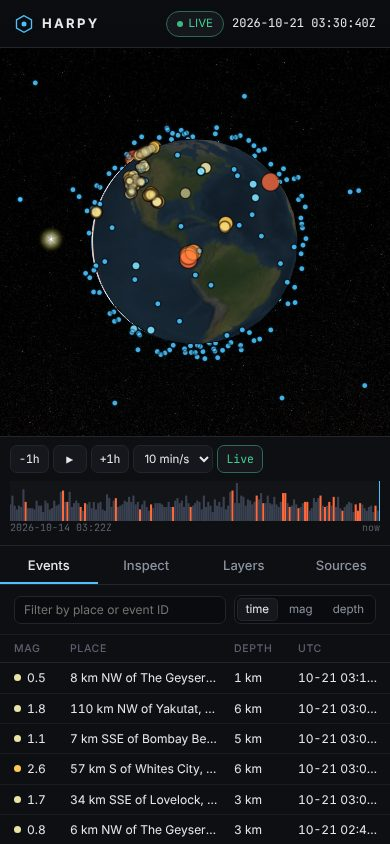

# Evidence: first live production run (2026-10-21)

This records what HARPY's production pipeline actually fetched and stored on its first run against the real upstream services. Every event ID below links to its USGS page, so anyone can verify that these are real records rather than generated ones.

| | |
|---|---|
| Workflow run | [Monitor (ingest + publish) #1](https://github.com/AngelP17/HARPY/actions/runs/39538049776), triggered by merging PR #5 |
| Commit | `3eac6bd` |
| Ingest time | 2026-10-21 03:22:07Z to 03:22:08Z |
| Database | Saved to the [`harpy-data`](https://github.com/AngelP17/HARPY/tree/harpy-data) branch: 3.6 MB SQLite, 452 KB zstd. `PRAGMA integrity_check` = ok |
| Steps | All green from checkout through **Live acceptance** and **Save observation database**. The run stopped at `configure-pages` because GitHub Pages had not been switched on yet. |

## Fetch log (verbatim from the database)

| Source | Endpoint | HTTP | Seen | New | Unchanged | Invalid | Duration |
|---|---|---|---|---|---|---|---|
| usgs | `all_week.geojson` (one-time backfill) | 200 | 1842 | 1842 | 0 | 0 | 199 ms |
| usgs | `all_day.geojson` | 200 | 214 | 0 | 214 | 0 | 17 ms |
| celestrak | `GROUP=stations` | 200 | 21 | 21 | 0 | 0 | 496 ms |
| celestrak | `GROUP=visual` | 200 | 155 | 152 | 3 | 0 | 135 ms |
| celestrak | `GROUP=gps-ops` | 200 | 32 | 32 | 0 | 0 | 139 ms |
| celestrak | `GROUP=weather` | 200 | 73 | 73 | 0 | 0 | 106 ms |

Two rows show the deduplication working:

- **USGS `all_day`:** all 214 events were already stored from the weekly backfill a second earlier, so they were recorded as unchanged, not duplicated.
- **CelesTrak `visual`:** three satellites in that group also appear in `stations` (for example the ISS). They were stored once, under the same identity.

## What was stored

| | Count |
|---|---|
| Earthquakes (distinct events) | 1,842, observed 2026-10-14 03:22Z to 2026-10-21 03:16Z |
| Satellites (distinct element sets) | 278 across 4 groups |
| Raw upstream records kept by SHA-256 | 2,120 |
| Magnitude spread | 1,500 below M2.5 · 232 M2.5 to 4.4 · 107 M4.5 to 5.9 · 3 M6+ |
| Largest contributing networks | `ak` 452 · `nc` 258 · `ci` 220 · `us` 184 · `av` 158 · `tx` 139 |

### Largest events in the window

| Event | Origin (UTC) | Mag | Place | Status |
|---|---|---|---|---|
| [us6000u2mq](https://earthquake.usgs.gov/earthquakes/eventpage/us6000u2mq) | 2026-10-16 03:35:31 | 6.9 | 76 km NE of Ozernovskiy, Russia | reviewed |
| [us6000u3jl](https://earthquake.usgs.gov/earthquakes/eventpage/us6000u3jl) | 2026-10-20 04:20:38 | 6.3 | 197 km NW of Port-Olry, Vanuatu | reviewed |
| [us6000u3bc](https://earthquake.usgs.gov/earthquakes/eventpage/us6000u3bc) | 2026-10-19 07:49:04 | 6.0 | 186 km NW of Port-Olry, Vanuatu | reviewed |
| [us6000u28y](https://earthquake.usgs.gov/earthquakes/eventpage/us6000u28y) | 2026-10-14 10:49:47 | 5.9 | Fiji region | reviewed |
| [us6000u2y1](https://earthquake.usgs.gov/earthquakes/eventpage/us6000u2y1) | 2026-10-17 05:06:57 | 5.7 | 48 km WNW of Khuzdar, Pakistan | reviewed |

### Panama region (a local check)

13 events in the week, including:

| Event | Origin (UTC) | Mag | Place |
|---|---|---|---|
| [us6000u3rr](https://earthquake.usgs.gov/earthquakes/eventpage/us6000u3rr) | 2026-10-21 01:20:02 | 5.0 | south of Panama |
| [us6000u3nl](https://earthquake.usgs.gov/earthquakes/eventpage/us6000u3nl) | 2026-10-20 17:05:48 | 5.4 | 192 km S of Burica, Panama |
| [us6000u3qu](https://earthquake.usgs.gov/earthquakes/eventpage/us6000u3qu) | 2026-10-20 22:51:44 | 4.3 | 6 km SE of Pitaloza Arriba, Panama |
| [us6000u33d](https://earthquake.usgs.gov/earthquakes/eventpage/us6000u33d) | 2026-10-18 05:00:13 | 4.3 | 2 km W of Pedasí, Panama |

### Sample satellites (element epoch = when the orbit was fitted)

| NORAD | Name | Group | Element epoch (UTC) | Perigee / apogee (km) | Period (min) |
|---|---|---|---|---|---|
| 25544 | ISS (ZARYA) | stations | 2026-10-20 15:51:33 | 415 / 424 | 93.0 |
| 48274 | CSS (TIANHE) | stations | 2026-10-20 22:31:33 | 383 / 386 | 92.2 |
| 20580 | HST | visual | 2026-10-20 11:06:00 | 468 / 471 | 94.0 |
| 43013 | NOAA 20 (JPSS-1) | weather | 2026-10-20 21:20:18 | 827 / 827 | 101.4 |
| 41866 | GOES 16 | weather | 2026-10-20 21:43:41 | 35,777 / 35,796 | 1436.1 |
| 39166 | GPS BIIF-4 (PRN 27) | gps-ops | 2026-10-19 19:52:05 | 19,800 / 20,565 | 718.0 |

The orbits come out physically right: ISS and Tiangong around 400 km with ~92-minute periods, GOES-16 geostationary (period ≈ one sidereal day), GPS at ~20,200 km with a 12-hour period.

## Live acceptance (13 checks, all passed)

Run by `scripts/live-acceptance.mjs` against the archive exported from this database:

| Check | Result |
|---|---|
| Archive generated in the last 15 min | pass |
| Contract version `harpy.observation/1` | pass |
| USGS provider reachable | pass (HEALTHY) |
| CelesTrak provider reachable | pass (HEALTHY) |
| USGS events in the last 24 h | pass (214) |
| USGS IDs look like real network event IDs | pass |
| Every event links back to its USGS event page | pass |
| No event is in the future | pass |
| Every event has a 64-hex record digest | pass |
| Hourly histogram populated | pass |
| ISS element set present | pass |
| ISS elements within 3 days | pass (epoch 2026-10-20 15:51Z) |
| Satellite element sets carry OMM for client SGP4 | pass |

The same script exits 1 when given stale data: run against the recorded test fixtures (ISS elements from 2020), "ISS elements within 3 days" fails.

## Honest-state behaviour seen in real data

- **Live view:** 277 of 278 satellites are drawn. ARKTIKA-M 1's newest element set (epoch 2026-10-17 02:34Z) was more than 3 days old at display time, so it is withheld and the UI says "1 satellite withheld".
- **Replay at 2026-10-17 07:02Z:** only 35 satellites are drawn. HARPY downloaded its first element sets on 2026-10-21, and most of them have epochs on 2026-10-20, more than 3 days after that instant. Only the 35 with an epoch inside the window qualify. The other 243 are withheld rather than extrapolated (screenshot below).

## Screenshots (this database, rendered by the production build)

Overview, live:


Earthquake inspector, full provenance for [us6000u3rr](https://earthquake.usgs.gov/earthquakes/eventpage/us6000u3rr):


Satellite inspector, ISS with SGP4 orbit track and evidence reference `celestrak:25544@1`:


Replay of recorded history:


Night style (a labelled visual style, not sensor data):


Mobile:



## How to reproduce

```bash
git fetch origin harpy-data
git show FETCH_HEAD:harpy.sqlite.zst > harpy.sqlite.zst && zstd -d harpy.sqlite.zst
cargo build --release -p harpy-core
./target/release/harpy-core check  --db harpy.sqlite
./target/release/harpy-core export --db harpy.sqlite --out site
node scripts/live-acceptance.mjs site/data/v1
```

The `harpy-data` branch is overwritten on each scheduled run, so it will hold newer data than this snapshot. The fetch log in this document is from the first run.
